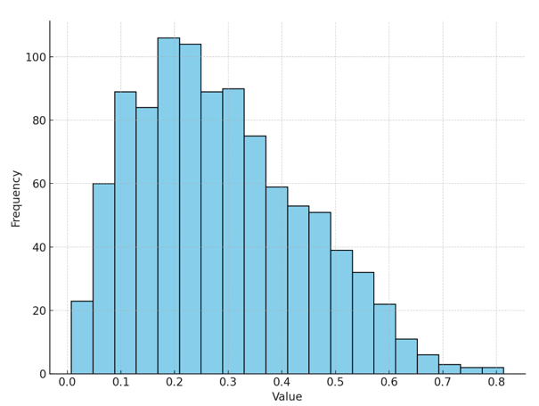
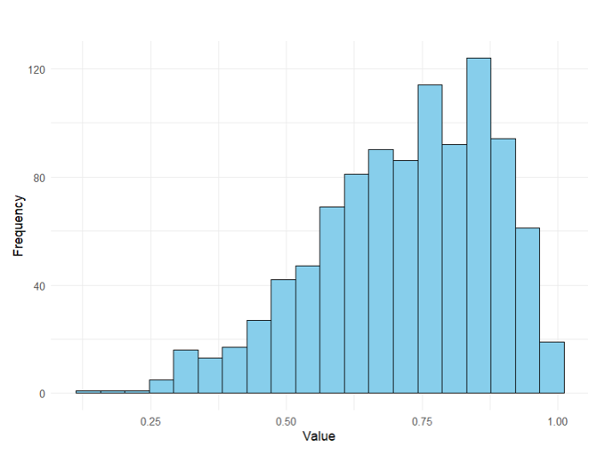
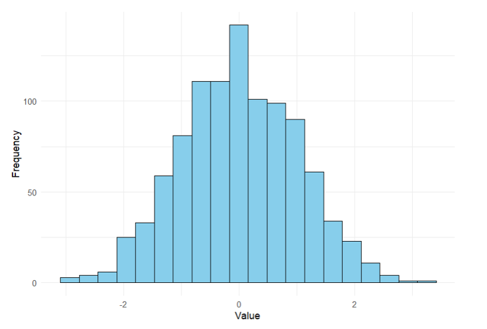
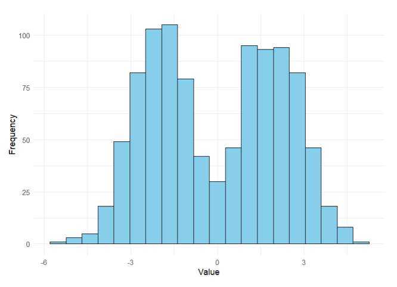

---
execute:
  enabled: false  # TODO: re-enable after datasets are added to data/
title: "Data Visualization"
format:
  revealjs:
    slideNumber: true
    scrollable: true
---

```{r}
suppressWarnings(suppressMessages(library(dplyr)))
suppressWarnings(suppressMessages(library(ggplot2)))
```

## Data Distribution

::: {.callout title="Definition 4.1"}
The **distribution** of a variable refers to which values a variable can take and how often (frequency) it takes on those values.
:::

## Frequency Table

One way to investigate the distribution of the data is using a **frequency table**.

::: {.callout title="Definition 4.2"}
A **frequency table** shows the ranges of values of a variable and how many observations fall within those ranges.
:::

## Ex: CS Data Age Dist

::: {.callout title="Example 4.1"}
Create a frequency table and display the results for age in the CS dataset.
:::

. . .

```{r, echo = TRUE}
cs_dataset <- read.csv("../data/cs_dataset.csv")
attach(cs_dataset)

age_binned <- cut(Age, 8)
table(age_binned)
```

```{r}
barplot(table(age_binned), space = 0,
        xlab = "Age Bins", ylab = "Frequency",
        xaxt = "n",
        main = "Age Frequency Distribution")

axis(side = 1, labels = FALSE)
text(x = 1:length(table(age_binned)),
     y = par("usr")[3] - 0.45,
     labels = names(table(age_binned)),
     xpd = NA,
     srt = 35,
     adj = 1.2,
     cex = 1)
```

## Ex: CS Data Income Dist

::: {.callout title="Example 4.2"}
Create a frequency table and display the results for income in the CS dataset.
:::

. . .

```{r, echo = TRUE}
income_binned <- cut(Income/1000, 10) # Income in Thousands
table(income_binned)
```

```{r}
barplot(table(income_binned), space = 0,
        xlab = "Income Bins", ylab = "Frequency",
        xaxt = "n",
        main = "Income Frequency Distribution")

axis(side = 1, labels = FALSE)
text(x = 1:length(table(income_binned)),
     y = par("usr")[3] - 0.45,
     labels = names(table(income_binned)),
     xpd = NA,
     srt = 35,
     adj = 1.2,
     cex = 1)
```

## Ex: Failure Data Age Dist

::: {.callout title="Example 4.3"}
Create a frequency table and display the results for failure time in the failure time dataset.
:::

. . .

```{r, echo = TRUE}
failure <- read.csv("../data/failure_time.csv")
attach(failure)

# YOUR CODE HERE (call variable ft_binned and use 8 bins)
```

```{r}
ft_binned <- cut(FailureTime, 8)

barplot(table(ft_binned), space = 0,
        xlab = "Failure Time Bins", ylab = "Frequency",
        xaxt = "n",
        main = "Failure Time Frequency Distribution")

axis(side = 1, labels = FALSE)
text(x = 1:length(table(ft_binned)),
     y = par("usr")[3] - 0.45,
     labels = names(table(ft_binned)),
     xpd = NA,
     srt = 35,
     adj = 1.2,
     cex = 1)
```

## Ex: Failure Data Time Dist

::: {.callout title="Example 4.4"}
Create a frequency table and display the results for engine temperature in the failure time dataset.
:::

. . .

```{r, echo = TRUE}
# YOUR CODE HERE (call variable temp_binned and use 10 bins)
```

```{r}
temp_binned <- cut(EngineTemp, 10)

barplot(table(temp_binned), space = 0,
        xlab = "Temperature Bins", ylab = "Frequency",
        xaxt = "n",
        main = "Temperature Frequency Distribution")

axis(side = 1, labels = FALSE)
text(x = 1:length(table(temp_binned)),
     y = par("usr")[3] - 0.45,
     labels = names(table(temp_binned)),
     xpd = NA,
     srt = 35,
     adj = 1.2,
     cex = 1)
```

## Visual Descriptions

Two key features to describe a distribution visually are its **skew** and **modality**.

## Skew

::: {.callout title="Definition 4.3"}
**Skew** is a measure of the asymmetry of a distribution.
:::

```{r}
par(mfrow = c(1, 3))
curve(dbeta(x, 2, 5), main = "Right (Positive) Skewed Distribution",
      xlab = "X", ylab = "Frequency")
curve(dbeta(x, 5, 5), main = "Normal (Symmetric) Distribution",
      xlab = "X", ylab = "Frequency")
curve(dbeta(x, 5, 2), main = "Left (Negative) Skewed Distribution",
      xlab = "X", ylab = "Frequency")
par(mfrow = c(1, 1))
```

## Skew, Mean, and Median

The mean is more affected by skew than the median. In general, the mean will be pulled in the direction of the skew.

You can use the relative position of the mean and median to obtain insights into whether the data are skewed:

-   If the mean is larger than the median, the data are skewed to the right
-   If the mean is smaller than the median, the data are skewed to the left
-   If the mean and median about the same, the data are more symmetric

## Ex: CS Data Skew

::: {.callout title="Example 4.5"}
Compute the mean and median for income and SAT score. What do these potentially say about the skew of these distributions?
:::

. . .

```{r, echo = TRUE}
mean(Income)
median(Income)

mean(SAT)
median(SAT)
```

## Ex: Failure Data Skew

::: {.callout title="Example 4.6"}
Compute the mean and median for failure time and shaft diameter. What do these potentially say about the skew of these distributions?
:::

. . .

```{r, echo = TRUE}
# YOUR CODE HERE
```

## Skew and Numeric Summaries

When data are symmetric, it is common to use the mean and variance/standard deviation as measures of central tendency and variability, respectively.

When data are skewed, the median and five-number summary give more informative descriptions of the central tendency and variability (spread) of the data, respectively.

## Ex: Identifying Skew

::: {.callout title="Example 4.7"}
Consider the visualization below. How would you describe the skew of this distribution? What is the relationship between the mean and the median in these data?

{width="331"}
:::

. . .

This distribution is ***right-skewed***. The mean of the data will be pulled in the direction of the skew, meaning the mean will be greater than the median.

## Ex: Identifying Skew

::: {.callout title="Example 4.8"}
Consider the visualization below. How would you describe the skew of this distribution? What is the relationship between the mean and the median in these data?

{width="336"}
:::

. . .

This distribution is ***YOUR ANSWER***. Why?

## Modality

::: {.callout title="Definition 4.4"}
**Modality** refers to the number of peaks of a distribution.
:::

When the data are multimodal, single measures of centrality and variability will be misleading.

```{r}
set.seed(100)

unimodal <- rnorm(1000)
bimodal <- rnorm(2000, rep(c(-2, 2), each = 1000))
multimodal <- rnorm(4000, rep(c(-8, -2, 2, 8), each = 1000))

par(mfrow = c(1, 3))
hist(unimodal, main = "Unimodal", xlab = "X")
hist(bimodal, main = "Bimodal", xlab = "X")
hist(multimodal, main = "Multimodal", xlab = "X")
par(mfrow = c(1, 1))
```

## Ex: Identifying Modality

::: {.callout title="Example 4.9"}
Consider the visualization below. Select the option that correctly describes the modality of the distribution.

{width="338"}
:::

. . .

This is a ***unimodal*** distribution (one peak).

## Ex: Identifying Modality

::: {.callout title="Example 4.10"}
Consider the visualization below. Select the option that correctly describes the modality of the distribution.

{width="336"}
:::

. . .

This is a ***YOUR ANSWER***. Why?

## Pie Charts

::: {.callout title="Definition 4.5"}
A **pie chart** is a type of graph in which a circle is divided into sectors that each represent a proportion of the whole.

These can be used to visualize qualitative data of any size.
:::

## Ex: CS Data Pie Chart

::: {.callout title="Example 4.11"}
Use a pie chart to create a visualization for ethnicity in the CS dataset.
:::

. . .

```{r, echo = TRUE}
#| out-width: "75%"
#| fig-align: center

ethnic_table <- table(Ethnicity)
ethnic_data <- data.frame(Ethnicity = names(ethnic_table), Count = as.numeric(ethnic_table))

ggplot(ethnic_data, aes(x = "", y = Count, fill = Ethnicity)) +
  geom_bar(stat = "identity", width = 1) +
  coord_polar("y") +
  labs(title = "Pie Chart of Ethnicity") +
  theme_void()
```

## Ex: Failure Data Pie Chart

::: {.callout title="Example 4.12"}
Use a pie chart to create a visualization of lubricant in the failure time dataset.
:::

. . .

```{r, echo = TRUE}
#| out-width: "75%"
#| fig-align: center

# YOUR CODE HERE
```

## Bar Charts

::: {.callout title="Definition 4.5"}
A **bar chart** can also be used to visualize qualitative data. It shows the count or proportion of observations in each category as a bar.

These can be used to visualize qualitative data of any size.
:::

## Ex: CS Data Bar Chart

::: {.callout title="Example 4.13"}
Use a bar chart to create a visualization for ethnicity in the CS dataset.
:::

```{r, echo = TRUE}
#| out-width: "70%"
#| fig-align: center

ethnic_table <- table(Ethnicity)
ethnic_data <- data.frame(Ethnicity = names(ethnic_table), Count = as.numeric(ethnic_table))
ethnic_data$Ethnicity <- ordered(ethnic_data$Ethnicity, levels = c("White", "Asian", "Hispanic/Latino", "Other", "African American/Black", "American Indian/Alaska Native"))

ggplot(ethnic_data, aes(x = Ethnicity, y = Count)) +
  geom_bar(stat = "identity") +
  labs(title = "Bar Chart of Ethnicity", x = "Ethnicity", y = "Count") +
  theme_minimal() +
  scale_x_discrete(labels = c("AA/Black", "AI/AN", "Asian", "Hisp/Lat", "Other", "White"))
```

## Ex: Failure Data Bar Chart

::: {.callout title="Example 4.13"}
Use a bar chart to create a visualization of material in the failure time dataset.
:::

```{r, echo = TRUE}
#| out-width: "70%"
#| fig-align: center

# YOUR CODE HERE
```

## Histograms

::: {.callout title="Definition 4.6"}
**Histograms** are useful for quantitative data when you wish to view the overall shape of the data for a large number of observations and you do not wish to identify specific parts of the distribution or outliers.
:::

## Ex: CS Data Histogram

::: {.callout title="Example 4.14"}
Create a histogram to visualize income in the CS dataset.
:::

. . .

```{r, echo = TRUE}
#| out-width: "70%"
#| fig-align: center

ggplot(cs_dataset, aes(x = Income)) +
  geom_histogram(binwidth = 10000, fill = "steelblue", color = "white") +
  labs(title = "Histogram of Income", x = "Income", y = "Frequency") +
  theme_minimal()
```

## Ex: Failure Data Histogram

::: {.callout title="Example 4.15"}
Create a histogram to visualize shaft diameter in the failure time dataset.
:::

. . .

```{r, echo = TRUE}
#| out-width: "70%"
#| fig-align: center

# YOUR CODE HERE
```

## Box Plots

::: {.callout title="Definition 4.7"}
Finally, **box plots** are another way to visualize quantitative data that specifically shows different parts of the five-number summary (as well as outliers)
:::

## Ex: CS Data Box Plot

::: {.callout title="Example 4.16"}
Create a box plot for income using the CS dataset.
:::

. . .

```{r, echo = TRUE}
#| out-width: "75%"
#| fig-align: center

ggplot(cs_dataset, aes(x = Income)) +
  geom_boxplot(fill = "lightblue", color = "black") +
  labs(title = "Box Plot of Income", x = "Income") +
  theme_minimal()
```

## Ex: Failure Data Box Plot

::: {.callout title="Example 4.17"}
Create a box plot for failure time in the failure time dataset.
:::

. . .

```{r, echo = TRUE}
#| out-width: "75%"
#| fig-align: center

# YOUR CODE HERE
```

## Ex: Large Data Visual

::: {.callout title="Example 4.18"}
Use the following description to identify the visualization:

This visualization is used to visualize the distribution of quantitative data when seeing individual outliers as points isn't needed.
:::

. . .

This best describes a ***histogram***. Histograms are especially useful for visualizing data distributions for large datasets without seeing individual data points or outliers.

## Ex: Categorical Visual

::: {.callout title="Example 4.19"}
Use the following description to identify the visualization:

This visualization uses bars to represent categorical data, where the length of each bar corresponds to the count or percentage of observations in each category.
:::

. . .

This best describes a ***bar chart***. Bar charts are used for categorical data where each category has its own bar showing the count or proportion of observations in that category.

## Ex: Seeing Outliers

::: {.callout title="Example 4.20"}
Use the following description to identify the visualization:

This visualization works well with small and large datasets, and is designed specifically to visualize the five-number summary including outliers.
:::

. . .

This best describes a ***YOUR ANSWER***. Why?

## Ex: Departments

::: {.callout title="Example 4.21"}
A company has surveyed its employees about their department, and the results are as follows: Sales (45), Marketing (30), HR (15), and IT (25). The data is categorical, and you want to compare the frequency of each department.

Which visualization would best display this data?
:::

. . .

Using a ***YOUR ANSWER*** would work best for these data. Why?

## Ex: Energy Consumption

::: {.callout title="Example 4.22"}
You have a large dataset containing monthly household energy consumption (in kWh) for 10,000 households. You would like to visualize the overall shape of the distribution and are not concerned with seeing specific observations, values, or identifying outliers.

Which visualization would best display this data?
:::

. . .

Using a ***YOUR ANSWER*** would work best for these data. Why?
