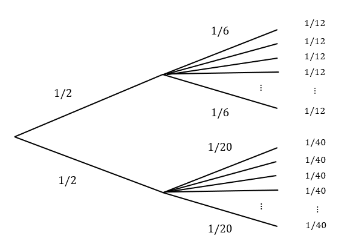

## Law of Total Probability (Simple)

::: {.callout title="Theorem 9.1"}
Let $A$ and $B$ be two events. Then the probability of $B$ occurring can be computed as:

$$P(B) = P(B \cap A) + P(B \cap A^C)$$

or equivalently

$$P(B) = P(B|A)P(A) + P(B|A^C)P(A^C)$$
:::

This says that there are two ways that $B$ could occur: $A$ could occur first and then $B$ could occur *or* $A^C$ could occur first and then $B$ could occur.

## Ex: Dice and Coins

::: {.callout title="Example 9.1"}
Consider an experiment where you flip a coin. If the coin is heads, you roll a six-sided die and if it is tails you roll a 20-sided die. What is the probability that you roll a number greater than 4?
:::



## Ex: Dice and Coins

::: {.callout title="Example 9.1 (Continued)"}
Consider an experiment where you flip a coin. If the coin is heads, you roll a six-sided die and if it is tails you roll a 20-sided die. What is the probability that you roll a number greater than 4?
:::

. . .

Let $>4$ be the event that we roll a number greater than 4 and $H$ be the event of flipping a head.

$$\begin{align}
P(>4) &= P(>4|H)P(H) + P(>4|H^C)P(H^C) \\
&= \frac{1}{3} \times \frac{1}{2} + \frac{16}{20} \times \frac{1}{2} = \frac{17}{30}
\end{align}$$

```{r, echo = TRUE}
1/3*1/2 + 16/20*1/2
```

## Ex: Medical Test

::: {.callout title="Example 9.2"}
A medical test is used to detect a certain disease. If a person has the disease, the probability that the test correctly detects the disease (true positive) is 95%. If a person does not have the disease, the probability that the test incorrectly indicates the presence of the disease (false positive) is 10%.

If 1% of individuals have the disease, then what is the probability a randomly selected individual tests positive for the disease?
:::

. . .

```{r, echo = TRUE}
# YOUR ANSWER HERE
```

## Ex: Components

::: {.callout title="Example 9.3"}
A factory has two machines, A and B, producing components. Machine A produces 60% of the components, and machine B produces 40%. Machine A has a 0.9 probability of producing a working component and a 0.1 probability of producing a defective one. Machine B has a 0.8 probability of producing a working component and a 0.2 probability of producing a defective one. What is the probability that a randomly selected component is working?
:::

. . .

```{r, echo = TRUE}
# YOUR ANSWER HERE
```

## Law of Total Probability (General)

::: {.callout title="Theorem 9.2"}
Assume sets $A_1, A_2, \dots, A_k$ are collectively exhaustive, meaning $S = \cup_{i=1}^k A_i$, and that they are all disjoint events. Then the probability of some event $B$ can be computed as follows:

$$P(B) = \sum_{i=1}^k P(B \cap A_i) = \sum_{i=1}^k P(B|A_i) P(A_i)$$
:::

The previous theorem is a special case of this theorem where $A_1 = A$ and $A_2 = A^C$. Again, we are just looking at all the different ways that event $B$ could occur and adding up these probabilities.

## Ex: Components

::: {.callout title="Example 9.4"}
A factory has three machines, A, B, and C producing components. Machine A produces 40% of the components, machine B produces 10%, and Machine C produces 50% of the components. The probabilities that the machines produce working components are 0.9, 0.8, and 0.7 respectively. If you randomly select a component, what is the probability it is a working component?
:::

. . .

Let $W$ be the event a component works and let $A$, $B$, and $C$ be the events that the component was produced by machines $A$, $B$, and $C$ respectively.

$$\begin{align}
P(W) &= P(W|A)P(A) + P(W|B)P(B) + P(W|C)P(C) \\
&= 0.9 \times 0.4 + 0.8 \times 0.1 + 0.7 \times 0.5 = 0.79
\end{align}$$

```{r, echo = TRUE}
machines <- c(0.4, 0.1, 0.5)
working <- c(0.9, 0.8, 0.7)

sum(machines*working)
```

## Ex: Car Inspection

::: {.callout title="Example 9.5"}
A car factory has three production lines: Line A, Line B, and Line C. Line A produces 30% of the cars, Line B produces 50%, and Line C produces 20%. The probabilities that a car from each line passes inspection are 0.95, 0.9, and 0.85, respectively. What is the probability that a randomly selected car passes inspection?
:::

. . .

Let $P$ represent passing the inspection and let $A$, $B$, and $C$ represent the car lines.

$$\begin{align}
P(P) &= P(P|A)P(A) + P(P|B)P(B) + P(P|C)P(C) \\
&= 0.95 \times 0.3 + 0.9 \times 0.5 + 0.85 \times 0.2 = 0.905
\end{align}$$

```{r, echo = TRUE}
lines <- c(0.3, 0.5, 0.2)
passes <- c(0.95, 0.9, 0.85)

sum(lines*passes)
```

## Ex: Fruit Quality

::: {.callout title="Example 9.6"}
A fruit packing company has three suppliers: Supplier X, Supplier Y, and Supplier Z. Supplier X provides 40% of the fruit, Supplier Y provides 35%, and Supplier Z provides 25%. The probabilities that a fruit from each supplier meets quality standards are 0.92, 0.88, and 0.81, respectively. What is the probability that a randomly chosen fruit meets quality standards?
:::

. . .

```{r, echo = TRUE}
# YOUR ANSWER HERE
```

## Bayes' Theorem (Simple)

::: {.callout title="Theorem 9.3"}
Let $A$ and $B$ be two events and that we know $P(B|A)$, $P(B|A^C)$ and $P(A)$ and we would like to know $P(A|B)$. Bayes' Theorem states that

$$P(A|B) = \frac{P(B|A)P(A)}{P(B)}$$

or equivalently

$$P(A|B) = \frac{P(B|A)P(A)}{P(B|A)P(A) + P(B|A^C)P(A^C)}$$
:::

## Bayes' Theorem (Proof)

Using the definition of conditional probability we have:

$$P(A|B) = \frac{P(A \cap B)}{P(B)}$$

We can then rewrite the joint probability $P(A \cap B$) as $P(B|A) P(A)$ which gives:

$$P(A|B) = \frac{P(B|A) P(A)}{P(B)}$$

## Ex: Dice and Coins

::: {.callout title="Example 9.7"}
Consider an experiment where you flip a coin. If the coin is heads, you roll a six-sided die and if it is tails you roll a 20-sided die. Someone performs the experiments and tells you they rolled a number greater than 4. What is the probability that they flipped a head?
:::

. . .

By Bayes' Theorem, we have:

$$\begin{align}
P(H|>4) &= \frac{P(>4|H)P(H)}{P(>4|H)P(H) + P(>4|H^C)P(H^C)} \\
&= \frac{\frac{1}{3}\times\frac{1}{2}}{\frac{1}{3}\times\frac{1}{2} + \frac{16}{20}\times\frac{1}{2}} \simeq 0.2941
\end{align}$$

```{r, echo = TRUE}
(1/3*1/2)/(1/3*1/2 + 16/20*1/2)
```

## Ex: Medical Test

::: {.callout title="Example 9.8"}
A medical test is used to detect a certain disease. If a person has the disease, the probability that the test correctly detects the disease (true positive) is 95%. If a person does not have the disease, the probability that the test incorrectly indicates the presence of the disease (false positive) is 10%. Assume that 1% of individuals have the disease.

If someone tests positive, what is the probability they have the disease?
:::

. . .

By Bayes' Theorem, we have:

\begin{align}
P(D|+) &= \frac{P(+|D)P(D)}{P(+|D)P(D) + P(+|D^C)P(D^C)} \\
&= \frac{0.95\times 0.01}{0.95\times 0.01 + 0.1 \times 0.99} \simeq 0.0876
\end{align}

```{r, echo = TRUE}
(0.95*0.01)/(0.95*0.01 + 0.1*0.99)
```

## Ex: Components

::: {.callout title="Example 9.9"}
A factory has two machines, A and B, producing components. Machine A produces 60% of the components, and machine B produces 40%. Machine A has a 0.9 probability of producing a working component and a 0.1 probability of producing a defective one. Machine B has a 0.8 probability of producing a working component and a 0.2 probability of producing a defective one.

You select a part and see it is defective, what is the probability it came from Machine A?
:::

. . .

```{r, echo = TRUE}
# YOUR ANSWER HERE
```

## Bayes' Theorem (General)

::: {.callout title="Theorem 9.4"}
Let $A_1, A_2, \dots, A_k$ and $B$ be events in $S$. Assume that for each $A_i$, we know $P(B|A_i)$ as well as $P(A_i)$. Then Bayes' Theorem states that the probability $P(A_i|B)$ for any of the $A_i$ is computed as:

$$P(A_i|B) = \frac{P(B|A_i)P(A_i)}{P(B)}$$

or equivalently

$$P(A_i|B) = \frac{P(B|A_i)P(A_i)}{\sum_{i=1}^k P(B|A_i) P(A_i)}$$
:::

## Ex: Components

::: {.callout title="Example 9.10"}
A factory has three machines: A, B, and C. Machine A produces 40% of the components, Machine B produces 10%, and Machine C produces 50%. The probabilities that the machines produce working components are 0.9, 0.8, and 0.7, respectively. If a randomly selected component is working, what is the probability that it was produced by Machine A?
:::

. . .

Let $W$ be the event a component works, and let $A$, $B$, and $C$ represent the events that the component was produced by Machines A, B, and C, respectively.

$$\begin{align}
P(A|W) &= \frac{P(W|A)P(A)}{P(W)} = \frac{0.9 \times 0.4}{0.79} \approx 0.4557
\end{align}$$

```{r, echo = TRUE}
machines <- c(0.4, 0.1, 0.5)
working <- c(0.9, 0.8, 0.7)

(0.4*0.9)/sum(machines*working)
```

## Ex: Car Inspection

::: {.callout title="Example 9.11"}
A car factory has three production lines: Line A, Line B, and Line C. Line A produces 30% of the cars, Line B produces 50%, and Line C produces 20%. The probabilities that a car from each line passes inspection are 0.95, 0.9, and 0.85, respectively. If a randomly selected car passes inspection, what is the probability it was produced on Line B?
:::

. . .

Let $P$ represent passing the inspection, and let $A$, $B$, and $C$ represent the production lines.

$$\begin{align}
P(B|P) &= \frac{P(P|B)P(B)}{P(P)} = \frac{0.9 \times 0.5}{0.905} \approx 0.4972
\end{align}$$

```{r, echo = TRUE}
lines <- c(0.3, 0.5, 0.2)
passes <- c(0.95, 0.9, 0.85)

(0.9*0.5)/sum(lines*passes)
```

## Ex: Fruit Quality

::: {.callout title="Example 9.12"}
A fruit packing company has three suppliers: Supplier X, Supplier Y, and Supplier Z. Supplier X provides 40% of the fruit, Supplier Y provides 35%, and Supplier Z provides 25%. The probabilities that a fruit from each supplier meets quality standards are 0.92, 0.88, and 0.81, respectively. If a randomly chosen fruit meets quality standards, what is the probability it came from Supplier Z?
:::

. . .

```{r, echo = TRUE}
# YOUR ANSWER HERE
```
